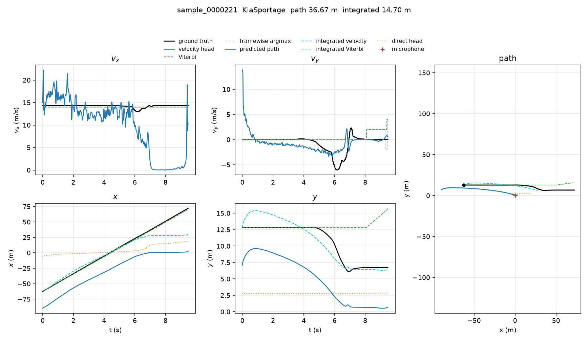
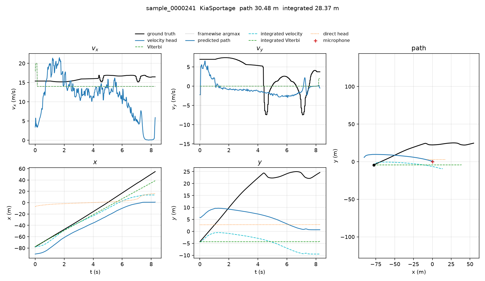
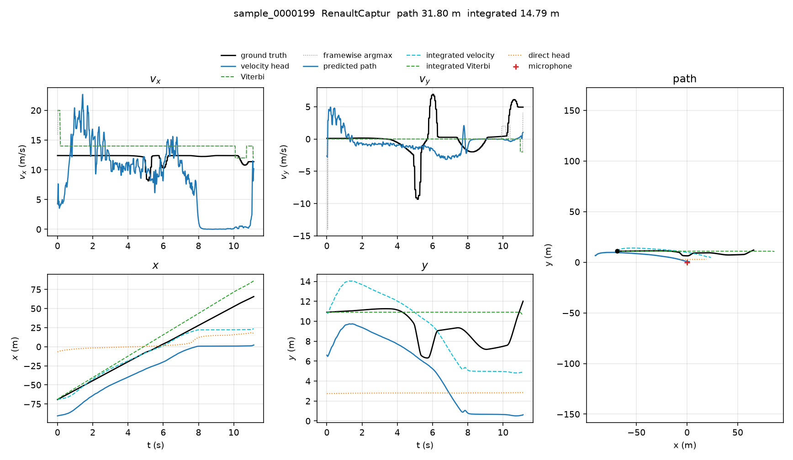
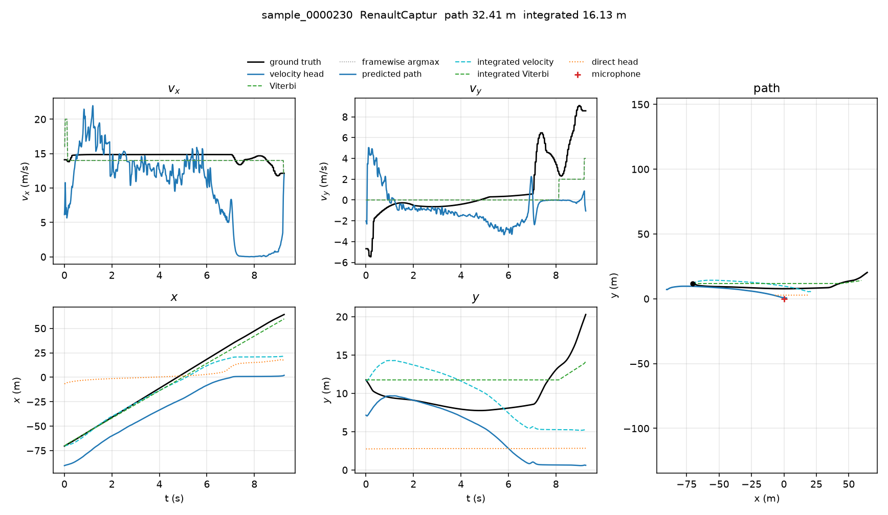
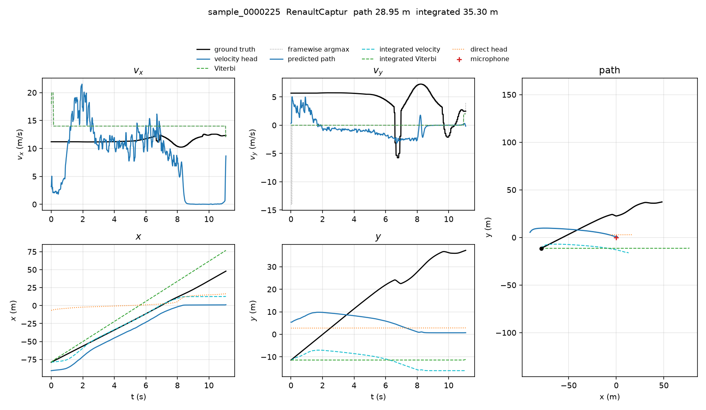

# Inference

This is the framewise motion model, `MotionNet`, checkpoint `outputs/motion/motion.pt`, kept from **epoch 27** of the bearing-and-range fine-tune. The summary is [`../../ABLATIONS.md`](../../ABLATIONS.md). Test vehicles are Kia Sportage and Renault Captur.

Each figure shows `vx`, `vy`, `x`, `y`, and the spatial path. Black is the ground truth. Blue is the derivative of the predicted path, and the blue path is that bearing-and-range curve. Cyan is the same velocity integrated from the true first position. Green is Viterbi on the bin heads, which is still nearly constant. The microphone is the red cross.

On all 200 test clips the velocity head has `vx` MAE **5.62 m/s**, `vy` MAE **2.39 m/s**, `Δvx` **0.290 m/s** per frame, `Δvy` **0.097 m/s** per frame. Integrated from the true start: RMSE **16.76 m**, orbit **16.31 m**, range **9.74 m**, closest point **3.66 m**. The audio-only path is at 35.73 m RMSE. Viterbi integration is at 7.77 m, because a constant `+14` m/s and `0` still matches more frames than the mistimed bend.

| Clip | Vehicle | Case | vx MAE | vy MAE | Δvx | Δvy | Integrated RMSE | Path RMSE |
|---|---|---|---:|---:|---:|---:|---:|---:|
| `sample_0000221` | KiaSportage | best | 5.48 m/s | 1.26 m/s | 0.315 | 0.086 | 14.70 m | 36.67 m |
| `sample_0001297` | KiaSportage | median | 5.21 m/s | 1.38 m/s | 0.247 | 0.080 | 16.47 m | 34.59 m |
| `sample_0000241` | KiaSportage | worst | 6.06 m/s | 4.99 m/s | 0.297 | 0.137 | 28.37 m | 30.48 m |
| `sample_0000199` | RenaultCaptur | best | 5.42 m/s | 2.08 m/s | 0.297 | 0.117 | 14.79 m | 31.80 m |
| `sample_0000230` | RenaultCaptur | median | 5.40 m/s | 2.73 m/s | 0.286 | 0.107 | 16.13 m | 32.41 m |
| `sample_0000225` | RenaultCaptur | worst | 5.12 m/s | 5.08 m/s | 0.266 | 0.112 | 35.30 m | 28.95 m |

Best, median, and worst are ranked by integrated RMSE. `Δvx` and `Δvy` are mean absolute frame-to-frame errors, in m/s.

## KiaSportage, best

`sample_0000221` — integrated RMSE 14.70 m, path 36.67 m.

## KiaSportage, median

`sample_0001297` — integrated RMSE 16.47 m, path 34.59 m.

## KiaSportage, worst

`sample_0000241` — integrated RMSE 28.37 m, path 30.48 m.

## RenaultCaptur, best

`sample_0000199` — integrated RMSE 14.79 m, path 31.80 m.

## RenaultCaptur, median

`sample_0000230` — integrated RMSE 16.13 m, path 32.41 m.

## RenaultCaptur, worst

`sample_0000225` — integrated RMSE 35.30 m, path 28.95 m.

