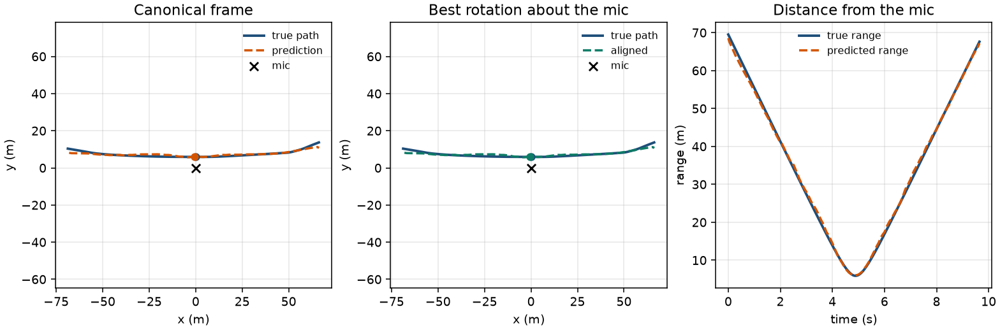
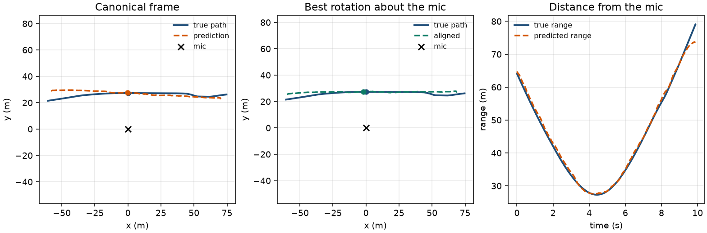
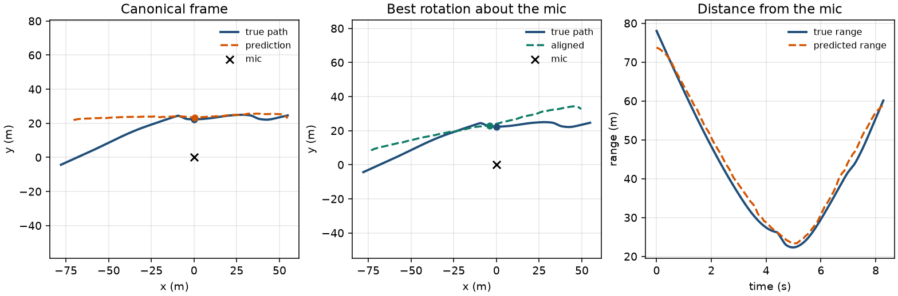
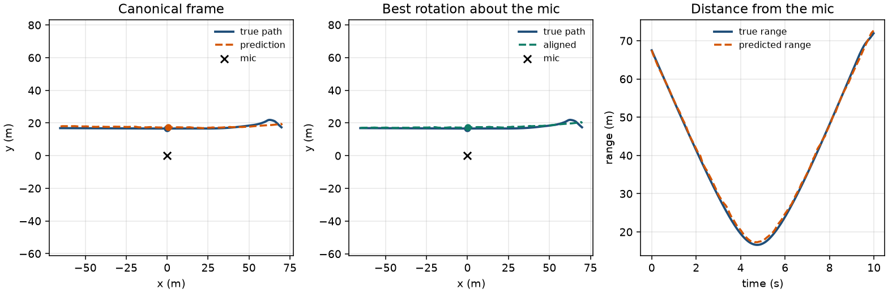
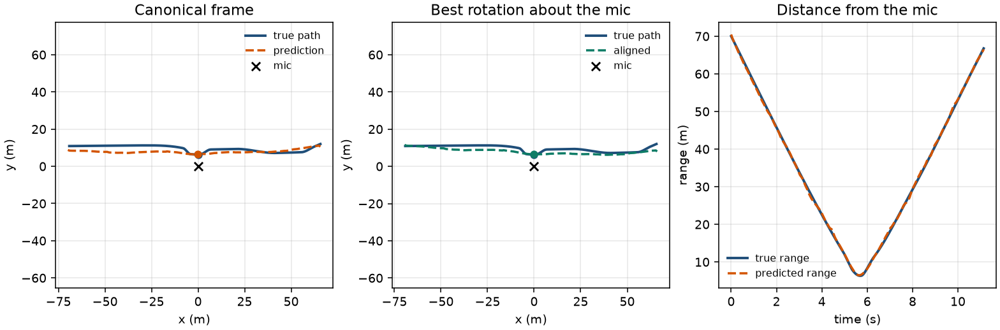
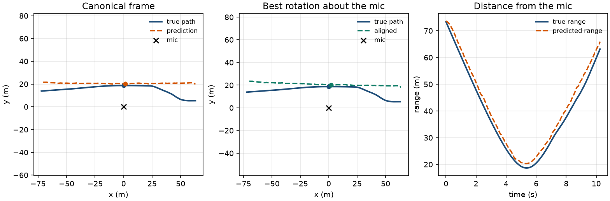

# Sample position predictions

Held-out clips from the fine-tuned range-and-direction model
(`range_polar_ft.pt`). Test vehicles are Kia Sportage and Renault Captur;
neither was seen in training.

The left panel is the network output in the canonical training frame
(closest approach on the positive y-axis). The middle panel rotates,
and if needed reflects, that output about the microphone so the path
lines up with the true trajectory. Dots mark the closest point.
Range does not change under that alignment.

Orbit RMS is the position error after that alignment. Range MAE is the
average absolute gap between the two range curves. CPA is the absolute
error of the closest-point distance.

| Clip | Vehicle | Case | Orbit RMS | Range MAE | CPA error |
|---|---|---|---:|---:|---:|
| `sample_0000328` | KiaSportage | best | 0.98 m | 0.55 m | 0.13 m |
| `sample_0001039` | KiaSportage | median | 2.15 m | 0.71 m | 0.26 m |
| `sample_0000241` | KiaSportage | worst | 7.26 m | 1.75 m | 1.04 m |
| `sample_0000172` | RenaultCaptur | best | 0.87 m | 0.52 m | 0.72 m |
| `sample_0000199` | RenaultCaptur | median | 2.04 m | 0.28 m | 0.15 m |
| `sample_0000612` | RenaultCaptur | worst | 6.95 m | 2.55 m | 1.65 m |

## KiaSportage, best

`sample_0000328` — orbit 0.98 m, range MAE 0.55 m, closest-point error 0.13 m.

## KiaSportage, median

`sample_0001039` — orbit 2.15 m, range MAE 0.71 m, closest-point error 0.26 m.

## KiaSportage, worst

`sample_0000241` — orbit 7.26 m, range MAE 1.75 m, closest-point error 1.04 m.

## RenaultCaptur, best

`sample_0000172` — orbit 0.87 m, range MAE 0.52 m, closest-point error 0.72 m.

## RenaultCaptur, median

`sample_0000199` — orbit 2.04 m, range MAE 0.28 m, closest-point error 0.15 m.

## RenaultCaptur, worst

`sample_0000612` — orbit 6.95 m, range MAE 2.55 m, closest-point error 1.65 m.

