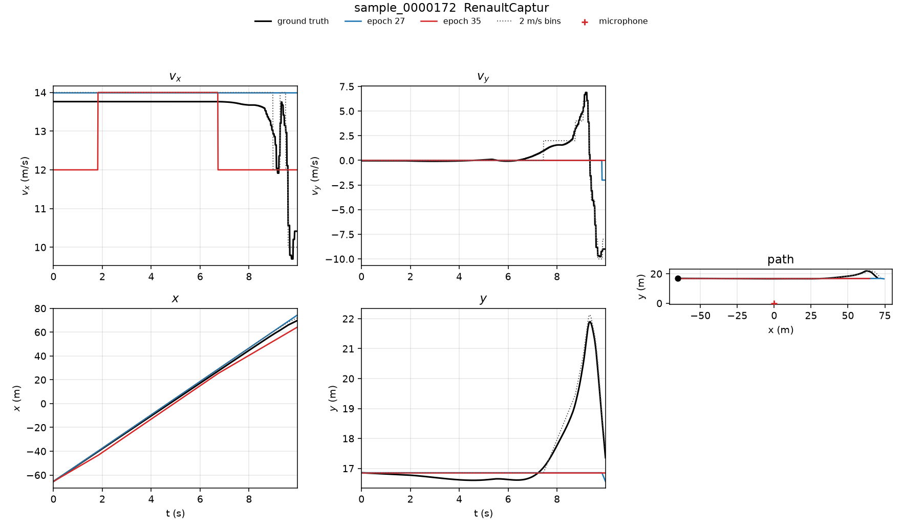
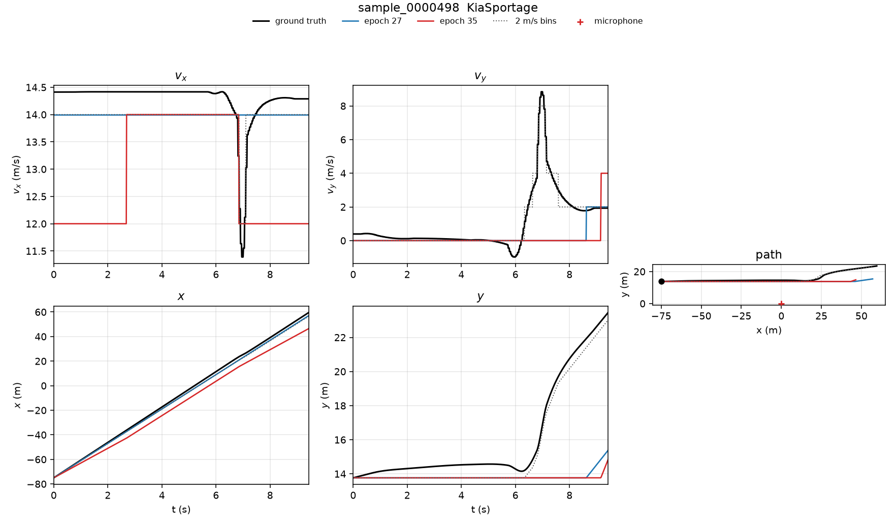

# Same-clip comparison of the two pictured checkpoints

The Renault Captur figure and the Kia Sportage figure came from two different full-dataset checkpoints. This comparison runs both on the same held-out audio, with the same trim, the same magnitude standardization, the same first-frame anchor, and the same decoder. A third full-dataset checkpoint, epoch 38, is scored on that protocol and is not drawn, so the overlays stay the two models in the two figures.

## Which checkpoint is which

| Role | File | What it is |
| --- | --- | --- |
| Previous figure | `outputs/motion/motion_polar_epoch27.pt` | Full-dataset fine-tune, saved at epoch 27. The file still contains a polar head and a direct position head. Inference uses only the \(v_x\) and \(v_y\) classifiers. |
| Current figure | `outputs/motion/motion.pt` | Full-dataset model, saved at epoch 35 of 40. Trained from scratch with the initial position as a network input. Validation integrated RMSE at the save was 9.38 m. |
| Earlier full-dataset reference | `outputs/motion/motion_epoch38.pt` | Full-dataset model, saved at epoch 38, before the polar fine-tune. No initial-position input. |

The current checkpoint is a full-dataset model. It was trained on the 900-clip training split (nine vehicles) and selected by validation loss. The one-clip minority-balance diagnostic never wrote weights, so it cannot be scored as a predictor. The separate 20-epoch class-balance runs live under `outputs/motion/balance_dominant/` and `outputs/motion/balance_frequency/` and are not these checkpoints.

Epoch 27 and epoch 35 are both general-purpose training runs, so the comparison below is a fair test-set comparison. They do differ in one input: epoch 35 receives \((x_0, y_0)\) on every encoder frame. Epoch 27 has no such layer. For that checkpoint the origin weights are held at zero, which leaves the encoder features unchanged. Both integrators start at the same measured \((x_0, y_0)\). Anchor error is 0 m on every trajectory in this report.

## Shared protocol

- Audio and labels: `load_arrays` on the 44.1 kHz clips, stationary pads removed, log-mel plus phase features, magnitude channels standardized with the training statistics.
- Frame time: \(512/44100 = 0.011610\) s.
- Alphabet: 2 m/s bins from \(-30\) to \(+30\) m/s.
- Decoder, identical for every model: independent Viterbi on each axis, graded transition cost with a 6 m/s jump limit and \(\lambda = 1\). A step of one bin costs 1, two bins cost 4, three bins cost 9, and a larger step is forbidden. Epoch 27 was trained at \(\lambda = 0.25\); this run decodes it at \(\lambda = 1\), the same setting as epoch 35 and epoch 38.
- Position: trapezoidal integral of the decoded bin centers, starting at the label position of the first moving frame.
- Oracle: the ground-truth \(v_x\) and \(v_y\) snapped to the nearest 2 m/s bin center, then integrated with that same trapezoid and the same anchor. This is the path error of the velocity grid alone.
- Turning region: frames whose ground-truth velocity on that axis differs from the mean of the first fifth of the clip by at least 2 m/s. A blank entry means the clip never leaves that opening velocity.
- Test split: 200 clips, Kia Sportage and Renault Captur, vehicle split with seed 0. Both named clips are in this split. `sample_0000172` is Renault Captur. `sample_0000498` is Kia Sportage.

The direct position head that appeared as an orange curve on the older Renault Captur figure is omitted. Every colored path here is an anchored velocity integral.

## Test set, 200 clips

Mean over the held-out vehicles. Lower is better.

| Model | \(v_x\) MAE | \(v_y\) MAE | Turning \(v_x\) MAE | Turning \(v_y\) MAE | Trajectory RMSE | Endpoint error |
| --- | ---: | ---: | ---: | ---: | ---: | ---: |
| 2 m/s bins | 0.48 | 0.38 | 0.50 | 0.46 | 2.55 m | 3.84 m |
| Epoch 38 | 0.98 | 1.48 | 2.06 | 3.98 | 6.74 m | 10.80 m |
| Epoch 27 (previous figure) | 1.10 | 1.50 | 2.67 | 3.93 | 7.77 m | 13.05 m |
| Epoch 35 (current figure) | 1.66 | 1.44 | 1.60 | 3.87 | 8.92 m | 15.38 m |

The 2 m/s grid accounts for 2.55 m of trajectory RMSE and 3.84 m of endpoint error. Epoch 38 sits 4.2 m above that floor. Epoch 27 sits 5.2 m above it. Epoch 35 sits 6.4 m above it. The remaining error is the velocity estimate.

Epoch 35 has the lowest turning \(v_x\) MAE of the three networks and a slightly lower \(v_y\) MAE than epoch 27. Those two numbers do not carry the path. Its cruise \(v_x\) is the weak axis (1.66 m/s against 1.10 and 0.98), and the integrated path and the endpoint are the worst of the three. Turning \(v_y\) is about 3.9 m/s for every network, against a bin floor of 0.46 m/s. The lateral spike is the part none of these checkpoints recover.

## The two clips in the figures

### `sample_0000172`, Renault Captur

The ground truth holds \(v_x \approx 14\) m/s and \(v_y \approx 0\) until the last second, then \(v_x\) falls through about 10 m/s and \(v_y\) spikes to about \(+7\) and \(-10\) m/s. The dotted oracle follows that spike in steps of 2 m/s. Both networks stay on \(v_y = 0\) until a last-frame step, so the miss is in the velocity heads. The bins already represent the spike well enough to bend \(y\) from 17 m to about 22 m.

Epoch 27 holds \(v_x = 14\) m/s for the whole cruise, so \(x(t)\) lies on the ground truth. Epoch 35 spends the opening and a later stretch at 12 m/s, and \(x(t)\) falls behind. Its turning \(v_x\) MAE is lower because that 12 m/s stretch overlaps the late slowdown. The long cruise, which dominates the integral, is the part it misses.

| | \(v_x\) | \(v_y\) | Turning \(v_x\) | Turning \(v_y\) | Trajectory RMSE | Endpoint |
| --- | ---: | ---: | ---: | ---: | ---: | ---: |
| 2 m/s bins | 0.29 | 0.21 | 0.35 | 0.53 | 1.41 m | 2.29 m |
| Epoch 38 | 0.51 | 1.03 | 1.83 | 5.66 | 1.69 m | 0.50 m |
| Epoch 27 | 0.46 | 1.00 | 3.83 | 5.44 | 2.08 m | 4.66 m |
| Epoch 35 | 0.93 | 1.03 | 1.83 | 5.66 | 3.65 m | 5.58 m |

Epoch 38’s 0.50 m endpoint is closer than the quantized integral’s 2.29 m because velocity errors cancel at the last frame. Its path RMSE, 1.69 m, remains above the 1.41 m bin floor.

### `sample_0000498`, Kia Sportage

Same shape of clip: a long \(+14, 0\) cruise, a brief \(v_x\) dip near 11.5 m/s, and a \(v_y\) spike to about 9 m/s that lifts \(y\) from 14 m to about 23 m. The oracle integral follows that lift. Epoch 27 steps \(v_y\) to \(+2\) m/s at the spike and reaches about 15 m. Epoch 35 stays at 0 until the last frames and reaches about 14 m. Both miss the bend that separates this path from a straight line.

Epoch 35’s turning \(v_x\) MAE equals the bin floor, 0.37 m/s, because the model is already at 12 m/s during the dip. Over the whole clip its \(v_x\) MAE is 1.41 m/s, against 0.41 m/s for epoch 27, and the path RMSE doubles from 4.06 m to 8.44 m.

| | \(v_x\) | \(v_y\) | Turning \(v_x\) | Turning \(v_y\) | Trajectory RMSE | Endpoint |
| --- | ---: | ---: | ---: | ---: | ---: | ---: |
| 2 m/s bins | 0.37 | 0.24 | 0.37 | 0.53 | 2.07 m | 3.04 m |
| Epoch 38 | 0.42 | 1.11 | 2.23 | 4.28 | 4.21 m | 10.03 m |
| Epoch 27 | 0.41 | 0.96 | 2.23 | 4.28 | 4.06 m | 8.46 m |
| Epoch 35 | 1.41 | 1.12 | 0.37 | 4.28 | 8.44 m | 15.65 m |

On these two clips the earlier figure is the better predictor. Both clips are close to the majority state \((+14, 0)\) until a short tail, which is why a model that stays on that state looks accurate in \(x\) and still misses the turn in \(y\).

## The other six overlays

These clips were fixed before the scores were computed. They are the other test clips that already had inference figures. Trajectory RMSE in meters:

| Clip | Vehicle | 2 m/s bins | Epoch 38 | Epoch 27 | Epoch 35 |
| --- | --- | ---: | ---: | ---: | ---: |
| sample_0000199 | Renault Captur | 2.35 | 2.22 | 12.58 | 4.66 |
| sample_0000225 | Renault Captur | 4.01 | 33.02 | 36.30 | 10.47 |
| sample_0000241 | Kia Sportage | 1.36 | 24.51 | 24.29 | 19.05 |
| sample_0000324 | Kia Sportage | 4.06 | 6.28 | 6.01 | 13.40 |
| sample_0000334 | Renault Captur | 0.36 | 0.69 | 1.03 | 7.77 |
| sample_0000346 | Kia Sportage | 0.97 | 0.87 | 0.97 | 3.42 |

`sample_0000199` is the case where epoch 35 beats epoch 27. The cruise is near 12 m/s. Epoch 27 spends most of the clip at 14 m/s and the path error is 12.58 m. Epoch 35 stays nearer 12–14 m/s and the path error is 4.66 m. Epoch 38 is at the bin floor on that clip (2.22 m against 2.35 m). The same pattern appears, more extremely, on `sample_0000225`, where epoch 27 and epoch 38 open at 20 m/s.

`sample_0000334` and `sample_0000346` never leave their opening velocity by 2 m/s, so they have no turning-region score. On `sample_0000346`, epoch 27 matches the quantized-velocity integral (0.97 m). Epoch 35 is at 3.42 m on the same straight clip.

## Reading the result

The Renault Captur figure looks better than the Kia Sportage figure because those are different clips and because epoch 27 holds the \(+14\) m/s cruise that both of those clips actually have. On the shared 200-clip test the ordering of path error is epoch 38 (6.74 m), epoch 27 (7.77 m), epoch 35 (8.92 m). The current checkpoint is the weakest of the three full-dataset models on trajectory RMSE and endpoint error.

The 2 m/s bins are a real floor, about 2.5 m of path RMSE, and they are not the reason the paths miss the lateral spike. The oracle integral bends with the ground-truth \(v_y\). The networks stay near 0 m/s through that spike. Turning \(v_y\) MAE stays near 4 m/s for every checkpoint.
