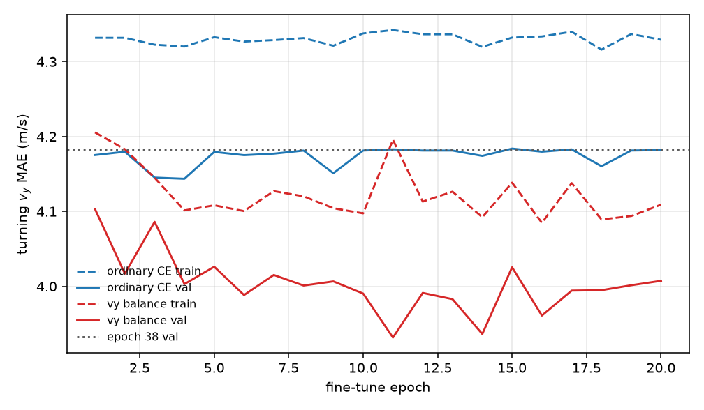

# Vy recovery from epoch 38

Selected checkpoint: **epoch 38 retained; neither fine-tune met the validation gate**.

The acoustic CNN stayed frozen. The BiLSTM and the two velocity heads were fine-tuned for 20 epochs at learning rate 1.0e-04, one tenth of the original base rate 1.0e-03. Both runs used the same full clips, the same shuffle, and the same 2260 updates. CTC and the anchored trajectory loss stayed at weight 0. Their code in `motion_loss.py` was not removed. Position, acceleration, and CTC heads were loaded from epoch 38 and left frozen. No origin input was added. The integrator still starts at the labeled `(x, y)`.

## Data checks, before training

Spectrogram frames are `1 + n_samples / 512` at 44.1 kHz. Label `frame_times` match `k * 512/44100` with a maximum error of 4.759e-07 s. Frame-count differences are between -1 and 0.

Renderer delay uses 343 m/s, the speed of sound in the path synthesizer. Every moving frame with `|vy| >= 2` has its reception time `t + range/c` inside the waveform (257007 / 257007). 15018 of those frames arrive during the stationary tail, which the existing trim does not feed to the network. The waveform itself contains them, and the label clock already matches the spectrogram clock, so the pairing was left as exported.

891 of 900 training clips contain both a zero `vy` bin and some other `vy` bin. Nonzero `vy` frames are 38.5% of training frames.

## Gate

On the validation vehicles, a fine-tune qualifies only if turning `vy` MAE is at most 90% of epoch 38, trajectory RMSE is lower, and `vx` MAE is at most 105% of epoch 38. The saved candidate is the qualifying epoch with the lowest validation trajectory RMSE. A run with no qualifying epoch is reported at its lowest validation turning-`vy` epoch and is not selected.

Epoch 38 retained; neither fine-tune met the validation gate.

## Comparison

Turning `vy` uses frames whose ground-truth `vy` has left the mean of the first fifth by at least 2 m/s. Zero-bin false motion is the fraction of frames labeled as the 0 m/s bin whose decoded bin is something else. Trajectory RMSE is the anchored Viterbi integral.

| Model | Split | Turning $v_y$ MAE | Zero-bin false motion | $v_x$ MAE | Trajectory RMSE |
| --- | --- | --- | --- | --- | --- |
| Epoch 38 | train | 4.343 | 0.000 | 0.857 | 6.407 |
| Epoch 38 | val | 4.183 | 0.000 | 0.918 | 6.681 |
| ordinary CE ep 4 | train | 4.320 | 0.003 | 0.737 | 5.768 |
| ordinary CE ep 4 not qualified | val | 4.144 | 0.002 | 0.752 | 5.917 |
| vy balance ep 11 | train | 4.196 | 0.080 | 0.725 | 5.779 |
| vy balance ep 11 not qualified | val | 3.932 | 0.087 | 0.748 | 5.969 |

Train and validation turning `vy` over the fine-tune:



## Wrong-audio ablation

Each validation state is scored twice on the same prefix: with its own spectrogram, and with the next validation clip's spectrogram. The anchor stays the true initial position.

| Model | Split | Turning $v_y$ MAE | Zero-bin false motion | $v_x$ MAE | Trajectory RMSE |
| --- | --- | --- | --- | --- | --- |
| epoch 38 | correct | 3.951 | 0.000 | 1.050 | 7.036 |
| epoch 38 | wrong clip | 3.951 | 0.000 | 1.360 | 8.642 |
| ordinary CE | correct | 3.931 | 0.001 | 0.949 | 6.572 |
| ordinary CE | wrong clip | 3.939 | 0.003 | 1.353 | 8.609 |
| vy balance | correct | 3.734 | 0.074 | 0.908 | 6.507 |
| vy balance | wrong clip | 4.008 | 0.079 | 1.380 | 8.813 |

## Configuration

```json
{
  "parent": "position_ctc/outputs/motion/motion_epoch38.pt",
  "architecture": "epoch 38 CNN + BiLSTM + separate vx/vy classifiers; pos and acc loaded and frozen; no origin input",
  "frozen": "conv, ctc_x, ctc_y, pos, acc",
  "trained": "rnn, vel_x, vel_y",
  "lr": 0.0001,
  "original_base_lr": 0.001,
  "weight_decay": 0.0001,
  "epochs": 20,
  "batch_size": 8,
  "seed": 0,
  "augmentation": "none",
  "crop": "none",
  "ctc": 0.0,
  "trajectory_loss": 0.0,
  "decoder": {
    "jump_mps": 6.0,
    "transition_lambda": 1.0,
    "dt_s": 0.011609977324263039
  },
  "anchor": "state[0] x,y",
  "vy_loss": "0.5 mean CE on zero bin + 0.5 mean CE on other bins, per clip",
  "vx_loss": "ordinary mean CE on valid frames",
  "gate": "val turning vy MAE <= 90% of epoch 38, lower trajectory RMSE, vx MAE <= 105% of epoch 38",
  "plot_clips": [
    "sample_0000172",
    "sample_0000498",
    "sample_0000002",
    "sample_0000014"
  ]
}
```

Existing checkpoints were read only. Their hashes were unchanged at the end of the run.
