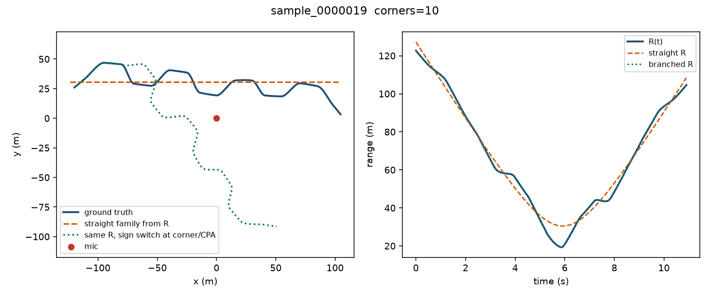
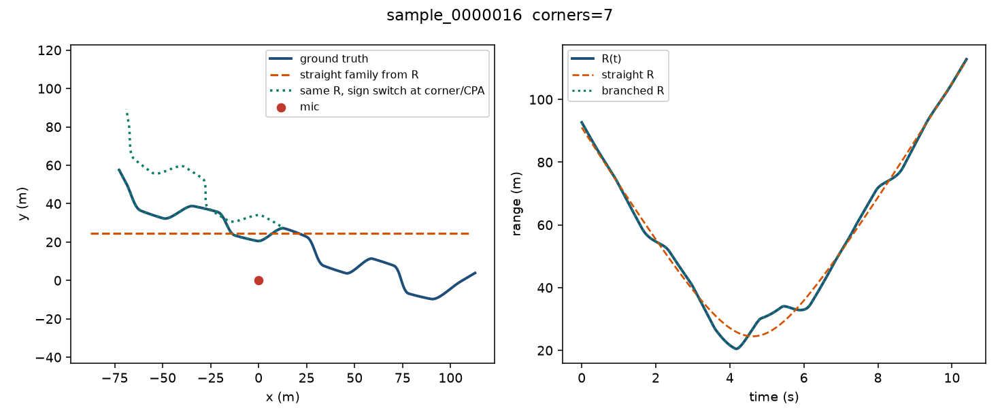
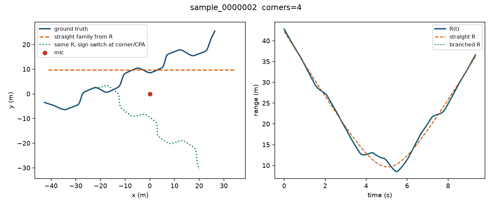

# Oracle range decoder

Exact ground-truth R(t) is the only observation. There is no audio and no learned model.
The path family is stated next to each row. Orbit alignment is a global rotation and
reflection about the microphone, with no translation, scale, or time warp.

Dataset: `$DOPPLER_PATH2D_CLIPS`. Discovered clips: 130. Scored clips: 130 (full set; decoder does not train).
Clips with a heading jump of at least 12 degrees: 128.
Labels are the observer-time centerline in `canonical_state_frames.npy`.

| Decoder | Motion assumption | Orbit | Range MAE | CPA |
|---|---|---:|---:|---:|
| `straight_family` | Constant-speed straight pass | 3.06 m | 1.31 m | 2.98 m |
| `range_rdot_speed_true_sign` | Known speed, GT sign of θ̇ | 0.05 m | 0.00 m | 0.00 m |
| `range_rdot_speed_constant_sign` | Known speed, one constant sign | 6.69 m | 0.00 m | 0.00 m |
| `range_rdot_no_speed` | Unknown speed, GT sign of θ̇ | 0.07 m | 0.00 m | 0.00 m |
| `global_sign_flip` | Known speed, global sign flip of theta-dot | 0.05 m | 0.00 m | 0.00 m |
| `corner_branch` | Known speed, sign switch after first corner or CPA | 9.68 m | 0.00 m | 0.00 m |

On clips with no heading jump, the straight family orbit is 1.83 m.
Switching the sign of theta-dot after the first 12-degree heading jump, or at CPA if none, leaves orbit 9.68 m.
Those branched paths share the radial profile. A global sign flip is a gauge and is removed by orbit alignment;
a sign switch at a corner is a different shape.

The reconstruction that is given the true sign of theta-dot and the true speed is the
identifiability ceiling for a range-and-rate decoder. Everything else is a missing motion assumption.

Figures: ground truth, the straight fit from R(t), and the same range with a sign switch at the first corner or CPA.

