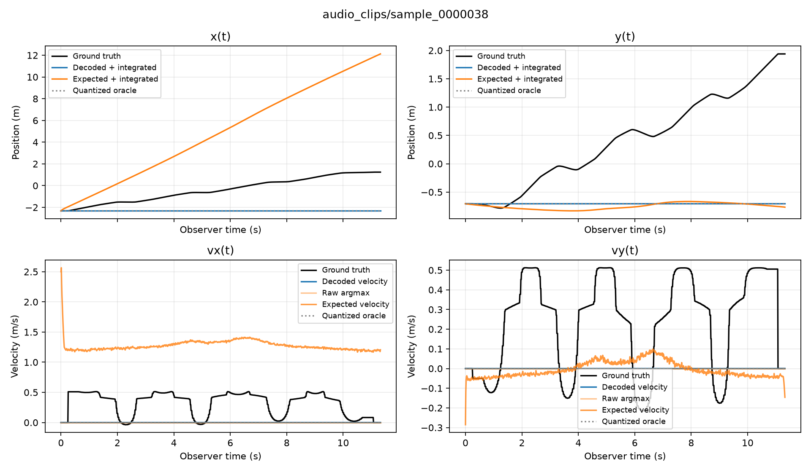
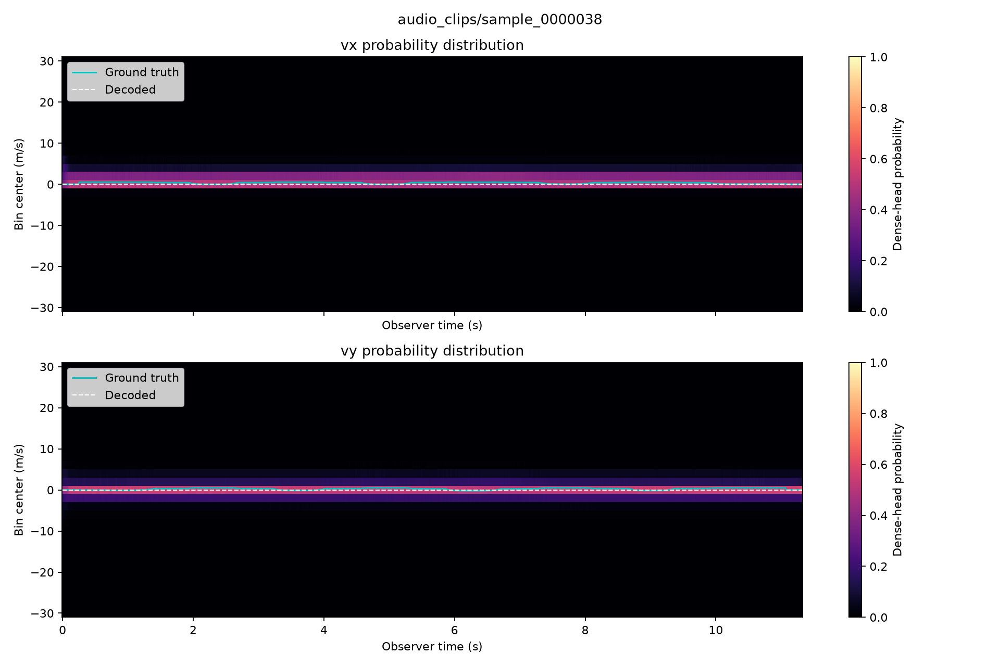
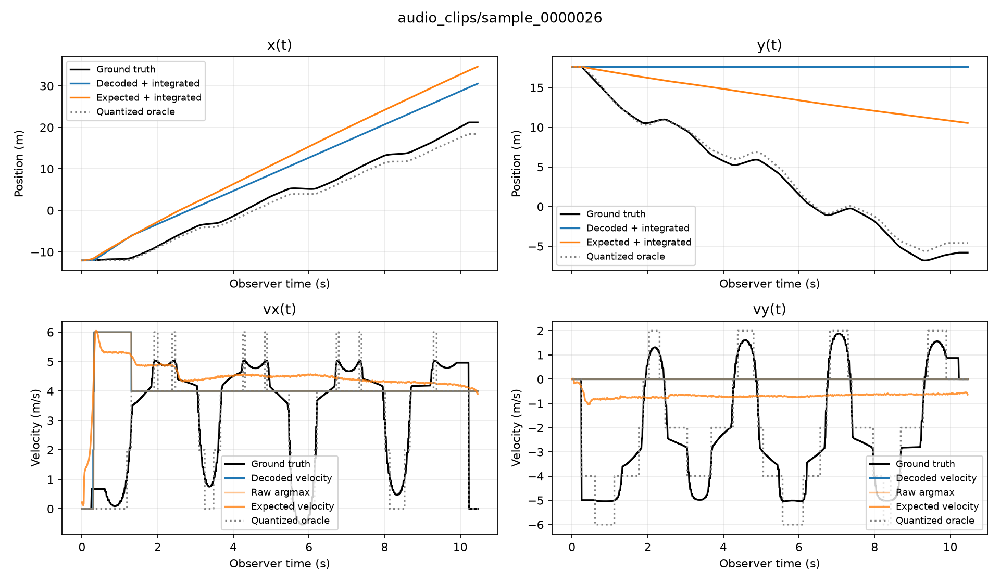
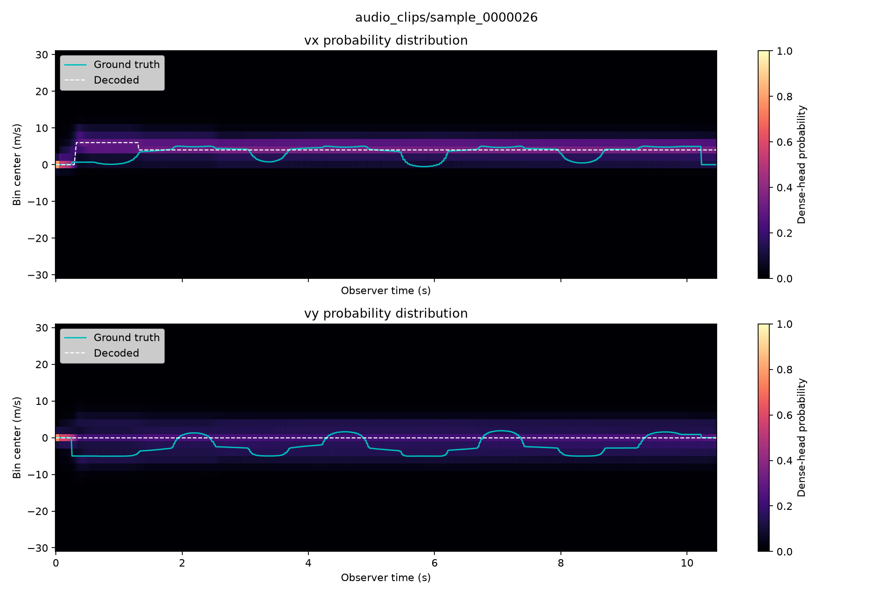
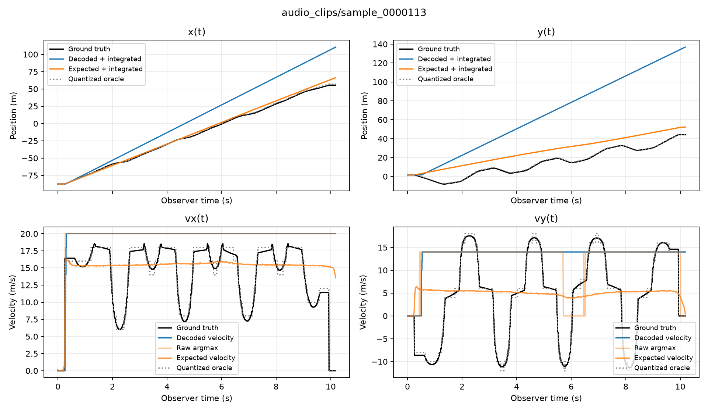
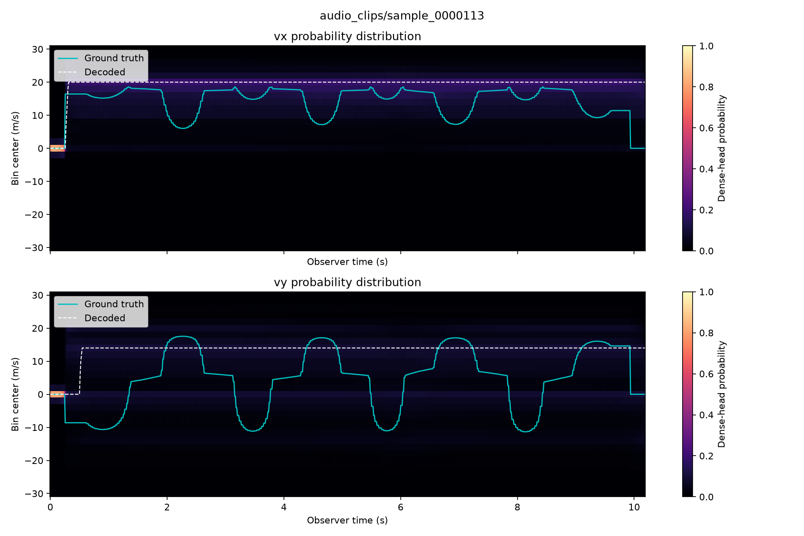
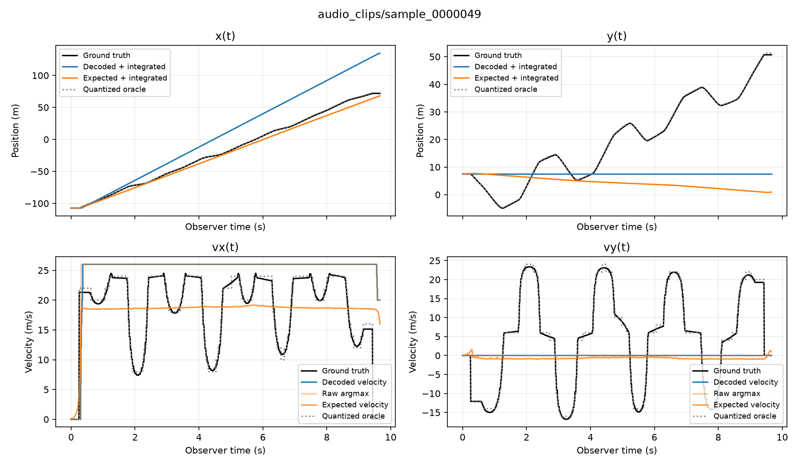
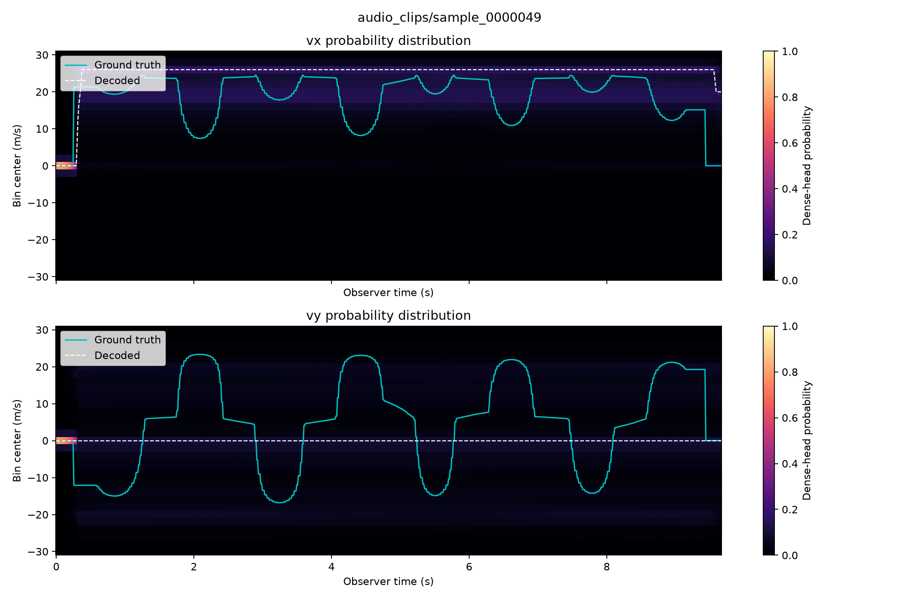

# Test cases: four graphs and probability heatmaps

Checkpoint `trajectory86_fixed/best.pt`, epoch 43.
These are the **test** split clips (`splits.json`), not the validation gallery.
The four graphs are x(t), y(t), vx(t), vy(t).
The heatmaps are the dense-head bin probabilities before Viterbi.

All 10 test clips: mean trajectory RMSE 23.38 m, mean vy MAE 6.39 m/s.

| Case | Clip | Trajectory RMSE | vx MAE | vy MAE | Endpoint |
|---|---|---:|---:|---:|---:|
| best trajectory RMSE | `audio_clips/sample_0000038` | 2.62 m | 0.32 m/s | 0.29 m/s | 4.44 m |
| median trajectory RMSE | `audio_clips/sample_0000026` | 16.87 m | 1.56 m/s | 2.81 m/s | 25.24 m |
| worst trajectory RMSE | `audio_clips/sample_0000113` | 64.12 m | 5.50 m/s | 10.11 m/s | 107.79 m |
| highest vy MAE | `audio_clips/sample_0000049` | 37.92 m | 6.78 m/s | 11.64 m/s | 76.19 m |

## best trajectory RMSE

`audio_clips/sample_0000038` — trajectory RMSE 2.62 m, vy MAE 0.29 m/s.

## median trajectory RMSE

`audio_clips/sample_0000026` — trajectory RMSE 16.87 m, vy MAE 2.81 m/s.

## worst trajectory RMSE

`audio_clips/sample_0000113` — trajectory RMSE 64.12 m, vy MAE 10.11 m/s.

## highest vy MAE

`audio_clips/sample_0000049` — trajectory RMSE 37.92 m, vy MAE 11.64 m/s.

